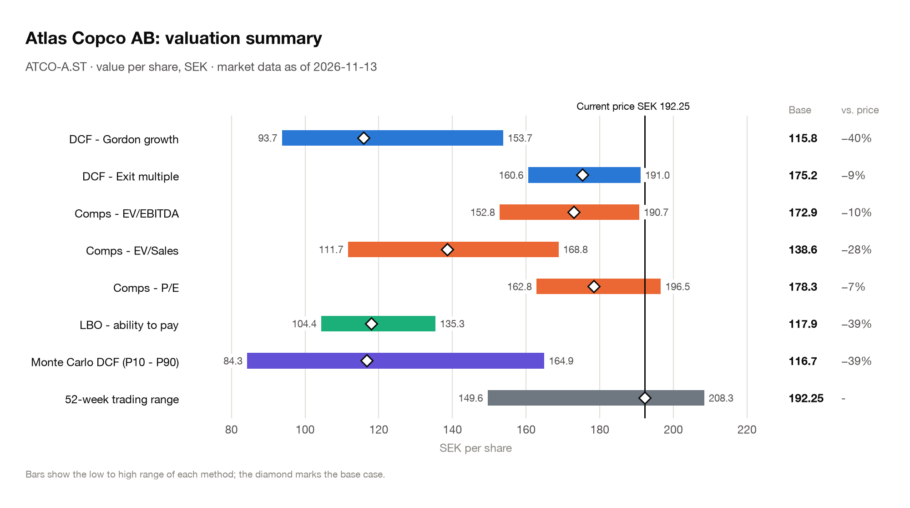
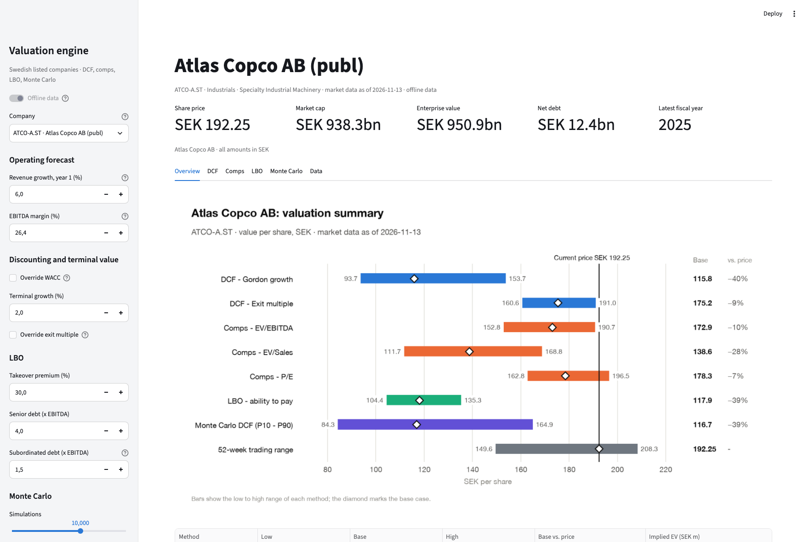
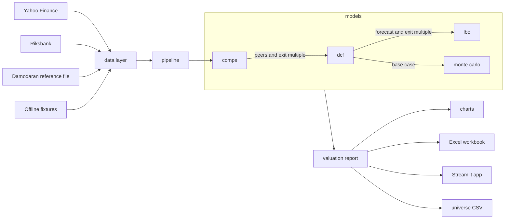

# valuation-engine

Give it a Swedish stock ticker and it tries to tell you what the company is worth, the way an investment bank would do it.

It pulls the numbers from Yahoo Finance, runs a handful of valuation methods on them and puts the results side by side, so you can see where they agree and where they don't. It works on every Swedish company Yahoo has (the `.ST` tickers), not just one. I built it to learn how these models actually work, so it tries hard to be honest about what it doesn't know.



That is Atlas Copco. Every bar is one method, the black line is the share price.

## What it does

- **DCF**: forecasts free cash flow five years out, discounts it with a WACC and adds a terminal value. Two versions: Gordon growth and exit multiple.
- **Trading comps**: picks similar companies and applies their EV/EBITDA, EV/Sales and P/E to the company.
- **LBO**: what could a private equity buyer pay and still hit its return target? Debt tranches, cash sweep, IRR and MOIC.
- **Monte Carlo**: runs the DCF 10,000 times with random growth, margin, WACC and terminal growth, so you get a range instead of one number.
- **Football field chart**: one picture with the range from every method.
- **Excel export**: a workbook with seven sheets, laid out like a bank model.
- **Streamlit app**: change the assumptions and watch the numbers move.
- **Batch mode**: values all 687 companies in about a minute and writes a CSV.

## Install

You need Python 3.11 or newer.

```bash
git clone https://github.com/arvidlindb/valuation-engine.git
cd valuation-engine
python -m venv .venv
source .venv/bin/activate
pip install -e ".[dev]"
```

## Quick start

### Try it offline first

The repo ships with frozen data for 15 companies, so this works straight after cloning. No network needed.

```bash
python -m valuation_engine ATCO-A.ST --offline
```

```
Atlas Copco AB (publ) (ATCO-A.ST)
Industrials, Specialty Industrial Machinery, market data as of 2026-11-13
Price SEK 192.25 | market cap SEK 938.3 bn | EV SEK 950.9 bn | net debt SEK 12.4 bn | FY2025

Value per share (SEK)
Method                                 Low        Base        High  Base/price   vs. price
Comps - EV/EBITDA                   152.81      172.93      190.71       0.90x      -10.1%
Comps - EV/Sales                    111.67      138.62      168.80       0.72x      -27.9%
Comps - P/E                         162.82      178.33      196.54       0.93x       -7.2%
DCF - Gordon growth                  93.73      115.85      153.74       0.60x      -39.7%
DCF - Exit multiple                 160.55      175.23      191.04       0.91x       -8.9%
LBO - ability to pay                104.38      117.93      135.34       0.61x      -38.7%
Monte Carlo DCF (P10 - P90)          84.29      116.74      164.92       0.61x      -39.3%
Current price                                   192.25
```

It also prints how the WACC was built, which peers were picked and where every market parameter comes from. I cut that part here.

The 15 offline companies are Atlas Copco and its industrial peers (Sandvik, Alfa Laval, SKF, Volvo, Epiroc, Trelleborg, Assa Abloy, Nibe, Indutrade), plus Hexagon, Autoliv, ABB, SEB and Verisure. Any other ticker needs real data, see below.

Setting `VALUATION_ENGINE_OFFLINE=1` does the same thing as `--offline`.

### Live data

```bash
python -m valuation_engine.data.download --all   # once, about 18 minutes
python -m valuation_engine VOLV-B.ST             # one company
python -m valuation_engine ERIC-B.ST HM-B.ST     # or several
```

Do the download first. Comps needs a table of every company to pick peers from, so the first live run fetches the whole universe anyway, and the download command at least shows what it is doing. You can stop it and start it again, it picks up where it left off. After that everything is read from a local cache in `.cache/` and a run takes a few seconds. Use `--refresh` when you want fresh numbers.

### Every Swedish company

```bash
python -m valuation_engine --all
```

```
687 companies in 69 s: no_data 7, ok 294, partial 386
```

"ok" means all four models gave a result. "partial" means at least one of them did not apply, which is normal: a bank gets no DCF, a company with losses gets no LBO.

### The app

```bash
streamlit run app/streamlit_app.py
```

Or with the offline data: `VALUATION_ENGINE_OFFLINE=1 streamlit run app/streamlit_app.py`.



### Tests

```bash
pytest
```

```
653 passed, 1 deselected in 61.48s
```

The tests run offline against the frozen data. The one deselected test needs the network (`pytest -m network`).

### Handy flags

| Flag | What it does |
|---|---|
| `--output-dir DIR` | where the files go (default `output`) |
| `--simulations N` | Monte Carlo runs (default 10,000, and 2,000 with `--all`) |
| `--seed N` | random seed (default 42) |
| `--no-size-premium` | plain CAPM, no size premium |
| `--universe-peers` | DCF takes beta and exit multiple from the whole industry instead of the comps peers |
| `--no-charts`, `--no-excel` | skip the charts or the workbook |
| `--limit N`, `--with-reports` | with `--all`: only the first N companies, or charts and Excel for each one |

`python -m valuation_engine --help` has the full list.

## Where the output lands

One company:

```
output/ATCO-A.ST/
  ATCO-A.ST_valuation.xlsx   Summary, Assumptions, DCF, Comps, LBO, Monte Carlo, Data
  summary.json               every number from the run
  charts/                    16 charts, each as PNG and SVG
```

The whole universe:

```
output/universe_valuation.csv   one row per company
output/universe_summary.md      coverage per method and why models did not apply
```

## How it fits together



The data layer turns Yahoo's raw statements into one standard set of line items, in the currency the share trades in. The models never see Yahoo or exchange rates. The pipeline runs comps first, hands the same peers to the DCF, and hands the DCF's forecast to the LBO, so the methods describe the same company.

## Method in brief

**DCF.** Five forecast years. Growth starts at the historical rate and fades in a straight line to 2%. Margin, D&A, capex and working capital are three year averages. The cost of equity is CAPM with a beta that averages the company's own (Blume adjusted) and its peers' (unlevered and relevered). Mid-year discounting. In the terminal year capex is at least as big as D&A, so the company does not shrink its asset base forever.

**Comps.** Candidates come from the same sector. They get clustered with k-means on size, growth, margin, return on equity, beta and leverage, and the nearest companies in the same cluster (12 at most) become the peers. Low, base and high are the 25th percentile, median and 75th percentile of the peer multiple.

**LBO.** A buyer pays the share price plus 30%, borrows up to 5.5x EBITDA (4.0x senior, 1.5x subordinated), sweeps all spare cash into the senior loan and sells after five years. The bar in the chart is the price that gives the buyer 25%, 20% or 15% a year.

**Monte Carlo.** Four inputs get a random shift around the DCF base case: growth, margin, WACC and terminal growth. Growth and margin are correlated. The median is reported as the central value, because the mean is pulled up by the shape of the formula and not by any real upside.

Some choices are not textbook, and you should know about them:

- **Size premium on top of CAPM.** Small companies get up to 3 percentage points added to the cost of equity (nothing above SEK 20 bn in market cap). The steps are my own assumption, not estimated from data. Turn it off with `--no-size-premium`.
- **K-means does less than the name suggests.** For about half the companies the best split is two clusters, and that mostly separates healthy companies from distressed ones. The real picking is done by the nearest neighbour ranking inside the sector, with a preference for the same industry.
- **The exit multiple is the comps median.** The exit DCF sells the company in year five at the multiple its peers trade at today (when at least five peers have one, and capped at 20x). So it inherits whatever the market is paying right now, and it is not an independent check on comps. The Gordon DCF is the only method that is.
- **The LBO is an ability to pay analysis.** It uses the DCF's operating forecast and exit multiple and asks what a buyer could pay. For a company the size of Atlas Copco that is a thought experiment, not a real deal.

## The Atlas Copco case

The methods put Atlas Copco at SEK 116 to 178 per share, against a price of SEK 192.25 on 13 November 2026. The Gordon DCF sits at the low end (116), the comps at the high end (173 to 178). The WACC is 7.65% and the exit multiple is 19.4x EBITDA.

The gap is almost all terminal value. To get to the share price you need a WACC around 6.2% together with 3% perpetual growth, where the model assumes 7.65% and 2%.

The full write-up is in [docs/case_report.md](docs/case_report.md) (in Swedish), and every number in it comes out of [notebooks/case_atco.ipynb](notebooks/case_atco.ipynb).

## Data sources

| What | Source | As of |
|---|---|---|
| Statements, prices, the company list | Yahoo Finance, through `yfinance` | prices 2026-11-13, fiscal year 2025 |
| Risk-free rate | Riksbank, 10 year Swedish government bond: 3.075% | 2026-11-13 |
| Exchange rates | Riksbank, average and year-end rate per fiscal year | per fiscal year |
| Equity risk premium | Damodaran, Sweden: 4.23% | January 2026 |
| Tax rate | Swedish corporate tax: 20.6% (Damodaran's table) | January 2026 |
| Terminal growth | 2%, the Riksbank inflation target | my assumption |

The risk-free rate is fetched live. The Damodaran numbers sit in a small JSON file in the repo (`src/valuation_engine/data/reference/market_reference.json`) that you update by hand about once a year.

The offline fixtures in `tests/fixtures/` are a frozen copy of the downloaded data: 15 companies in full, plus the company list and the peer table for the whole universe. That is why comps works offline too.

## Limitations

- **Yahoo data is free and it shows.** Some companies have missing or odd numbers. Yahoo's EBIT is not the company's reported operating profit. Nobody has checked the numbers against annual reports. [docs/data_mapping.md](docs/data_mapping.md) lists what I found.
- **Four years of history.** Every "historical average" is three or four numbers.
- **Last fiscal year against today's price.** The statements are for 2025, the price is from November 2026. No trailing twelve months, no stub period.
- **Leases.** Lease debt counts as debt, but lease payments are in neither EBITDA nor capex. Cash flows for lease-heavy companies come out a bit too high.
- **Banks, insurers, investment companies and real estate only get a P/E comparison.** A DCF on free cash flow and an LBO make no sense for them.
- **Only about 43% of companies get a DCF** (296 of 687). The rest have negative EBITDA, are financials, or have margins too thin for a positive cash flow. 82 companies get no value at all.
- **Value against price is all over the place.** Across the universe the Gordon DCF has a median of 1.11 times the share price, but one company in ten comes out below 0.33 and one in ten above 2.99. Only 27% land within 25% of the price. It also values small companies high and large ones low.
- **Growth for companies that do not report in SEK includes currency moves.** That is 63 companies.
- **Thin industries get mixed peers.** Autoliv ends up next to H&M and Betsson.
- **This is a learning project and not investment advice.** It shows what a set of assumptions gives you and what the share price requires. It does not tell you what to buy.

## Project layout

```
src/valuation_engine/
  core/         shared data types that everything else builds on
  data/         Yahoo and Riksbank fetching, caching, cleanup, currency conversion
  models/       dcf, comps, lbo, monte_carlo
  viz/          charts
  export/       Excel
  pipeline.py   runs all the models on one company
  batch.py      runs the pipeline on every company
  __main__.py   the command line
app/            Streamlit app
notebooks/      the Atlas Copco case
tests/          tests and the offline fixtures
docs/           case report, data mapping, study guide, figures
```

## More to read

- [docs/case_report.md](docs/case_report.md): the Atlas Copco case (Swedish)
- [notebooks/case_atco.ipynb](notebooks/case_atco.ipynb): the notebook behind it
- [docs/data_mapping.md](docs/data_mapping.md): how Yahoo's line items are mapped, and the data problems (Swedish)
- [docs/larguide.pdf](docs/larguide.pdf): a study guide to the methods and the code (Swedish)
- [PLAN.md](PLAN.md): design decisions and known weaknesses (Swedish)
- [CHANGELOG.md](CHANGELOG.md)
