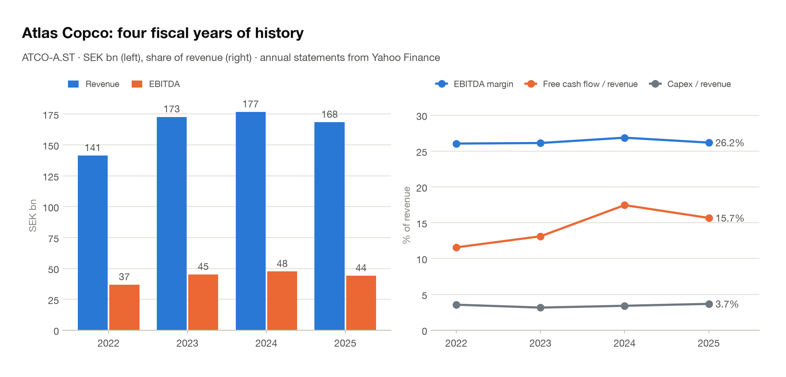
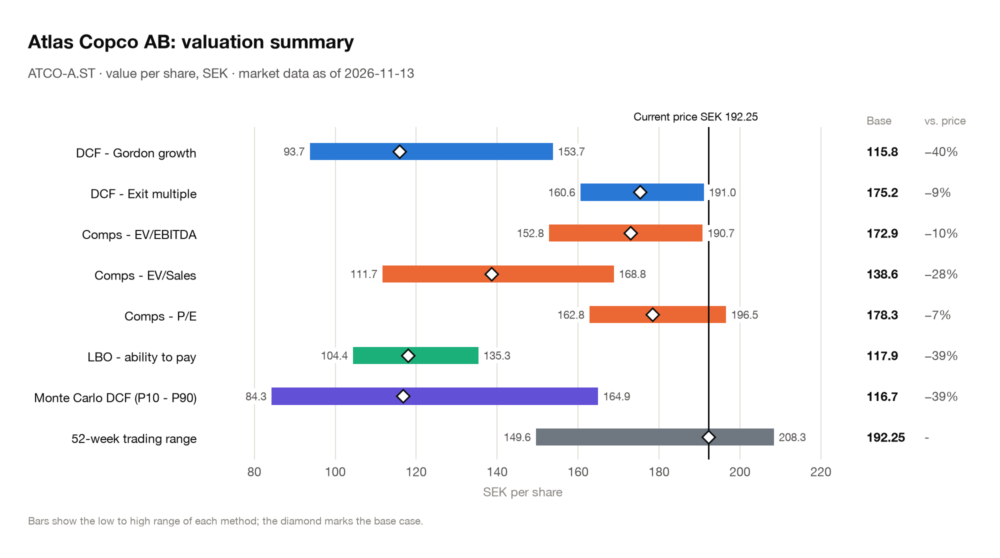
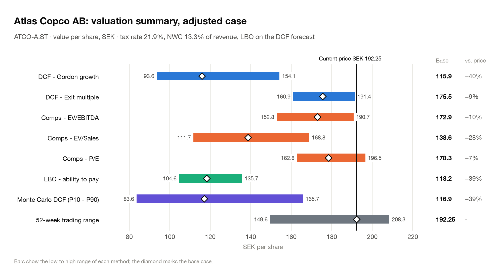
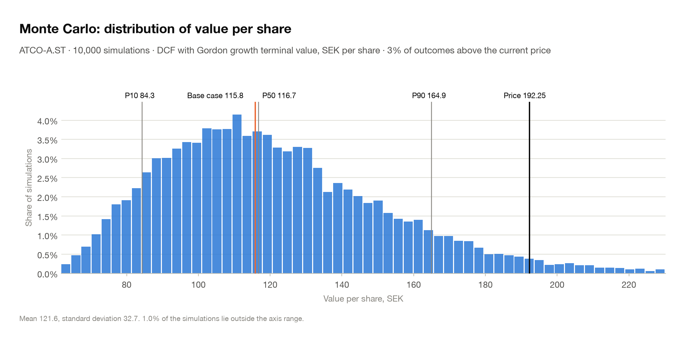
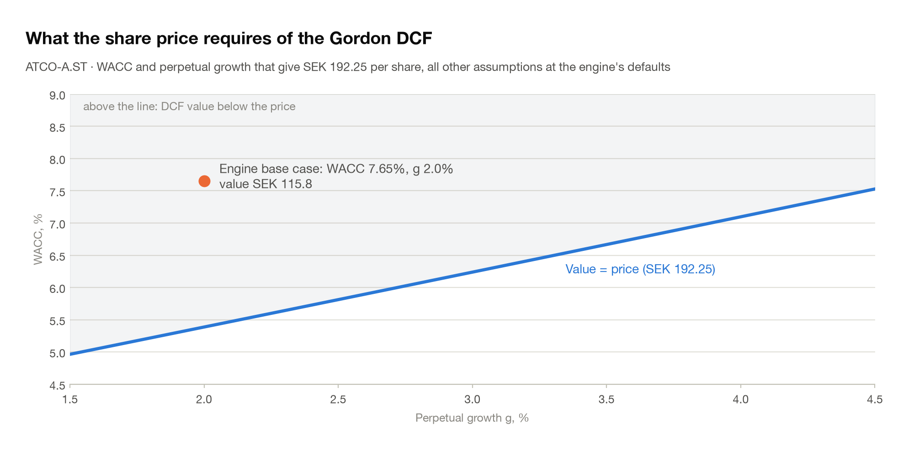
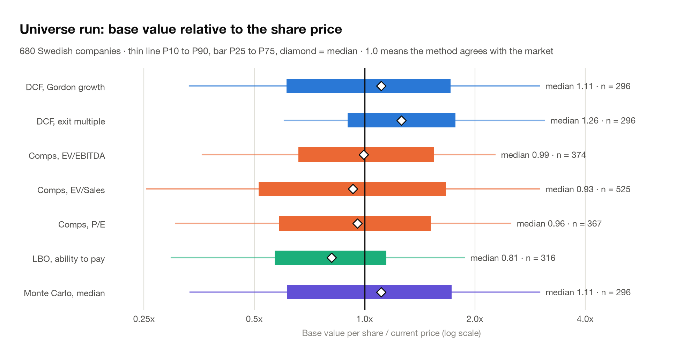

# Case: vad är Atlas Copco värt?

*Värdering av Atlas Copco (ATCO-A.ST) med `valuation-engine`. Kurs 192,25 kr per den 13 november 2026, bokslutsdata för 2025.*

**Kort svar:** motorns metoder ger ett värdeintervall på 116 till 178 kr per aktie mot en aktuell kurs på 192,25 kr. Kassaflödesvärderingen hamnar i den nedre änden, jämförelsebolagen i den övre. Kursen går att räkna hem, men bara om man godtar ett lägre avkastningskrav eller en högre evig tillväxt än modellen antar. Resten av rapporten förklarar hur siffrorna kommer till, var de är svaga och varför metoderna inte är överens.

Det här är ett läroexempel och ingen investeringsrådgivning.

Alla tal kommer från en och samma körning av [notebooks/case_atco.ipynb](../notebooks/case_atco.ipynb), som går offline mot de data som ligger i repot. Talen är avrundade en gång, från det oavrundade värdet och med halvor uppåt. Gordon-värdet 115,846 blir alltså 115,8 med en decimal, även om motorns utskrift med två decimaler visar 115,85. Diagrammen är motorns egna och har därför engelsk text.

## 1. Bolaget i korthet

Atlas Copco är en svensk industrikoncern. Yahoo placerar bolaget i sektorn Industrials och branschen Specialty Industrial Machinery. (Ur allmän kännedom, inte ur datat: bolaget är mest känt för kompressorer, vakuumteknik och industriverktyg.)

Det datat visar är ett stort och lönsamt bolag med jämna marginaler. Omsättningen 2025 var 168 mdkr, EBITDA 44 mdkr och nettovinsten 26 mdkr. Börsvärdet är 938 mdkr, vilket gör bolaget till det näst största i sin sektor på Stockholmsbörsen efter ABB. Nettoskulden är bara 12 mdkr, så rörelsevärdet (EV, börsvärde plus nettoskuld) är 951 mdkr.



| Post | 2022 | 2023 | 2024 | 2025 |
|---|---:|---:|---:|---:|
| Omsättning, mdkr | 141,3 | 172,7 | 176,8 | 168,3 |
| Tillväxt |  | 22,2 % | 2,4 % | -4,8 % |
| EBITDA-marginal | 26,1 % | 26,1 % | 26,9 % | 26,2 % |
| Avskrivningar / omsättning | 4,5 % | 4,5 % | 5,0 % | 5,7 % |
| Capex / omsättning | 3,6 % | 3,2 % | 3,4 % | 3,7 % |
| Rörelsekapital, smalt | 26,9 % | 25,6 % | 26,0 % | 23,9 % |
| Rörelsekapital, brett | 13,8 % | 13,6 % | 13,5 % | 12,8 % |
| Effektiv skatt | 21,8 % | 23,0 % | 21,2 % | 21,5 % |
| Fritt kassaflöde, mdkr | 16,3 | 22,6 | 30,9 | 26,4 |
| Förvärv, mdkr | 10,6 | 4,3 | 7,4 | 11,6 |

Två saker i tabellen styr mycket av det som följer. Tillväxten är ojämn: nästan hela ökningen sedan 2022 kom under ett enda år. Och bolaget köper andra bolag för 4 till 12 mdkr om året, vilket syns i omsättningen men inte i investeringarna (capex).

## 2. Data och dess gränser

All bolagsdata kommer från Yahoo Finance: fyra årsbokslut, den senaste kvartalsbalansräkningen och fem års veckokurser. Riskfri ränta kommer från Riksbanken, riskpremie och skattesats från Damodarans tabeller.

Tre tidpunkter blandas. Kursen är från den 13 november 2026, skuld och kassa från den 30 september 2026, och resultatet från helåret 2025. Yahoos rullande tolvmånaderssiffror, som motorn inte använder, visar en omsättning på 176 mdkr, alltså 4,7 % över det basår modellen utgår från. Fyra år är också en kort historik: en "treårig tillväxttakt" är tre observationer.

## 3. Antaganden och varför

Motorn räknar fram standardantaganden mekaniskt ur historiken. Jag har ställt vart och ett mot tabellen ovan.

| Antagande | Motorns standard | Varifrån | Min bedömning |
|---|---|---|---|
| Omsättningstillväxt | 6,0 % år 1, linjärt ned till 2,0 % år 5 | Årlig tillväxt 2022 till 2025 | Behålls, med tvekan |
| EBITDA-marginal | 26,4 % alla år | Snitt av tre år | Behålls |
| Avskrivningar | 5,0 % av omsättningen | Snitt av tre år | Behålls |
| Capex | 3,4 % av omsättningen, i slutvärdet minst lika med avskrivningarna | Snitt av tre år | Behålls |
| Rörelsekapital | 25,2 % av omsättningen | Kundfordringar plus lager minus leverantörsskulder, snitt av tre år | **Ändras till 13,3 %** |
| Skattesats | 20,6 % | Svensk bolagsskatt (Damodaran) | **Ändras till 21,9 %** |
| Evig tillväxt | 2,0 % | Riksbankens inflationsmål, projektets val | Behålls |
| Riskfri ränta | 3,075 % | Riksbanken, tioårig statsobligation, 2026-11-13 | Källbelagd |
| Riskpremie | 4,23 % | Damodaran, Sverige, januari 2026 | Källbelagd |
| Beta | 1,13 | Snitt av eget (1,17) och jämförelsebolagens (1,08) | Behålls |
| WACC | 7,65 % | CAPM, 96 % eget kapital | Följer av raderna ovan |
| Exit-multipel | 19,4 gånger EBITDA | Samma median som i comps: 11 jämförelsebolag, efter att en uteliggare tagits bort | Behålls, se avsnitt 6 |
| LBO: rörelseprognos | Samma som DCF:ens | Pipelinen för över tillväxt, marginal, avskrivningar, capex, rörelsekapital och skatt | Behålls |
| LBO: finansiering | 30 % budpremie, skuld 5,5 gånger EBITDA, avkastningskrav 15, 20 och 25 % | Motorns konventioner | Behålls |

**Tillväxten** behåller jag, men den är det svagaste antagandet. Sex procent om året är den genomsnittliga årliga tillväxttakten (CAGR) över tre år med +22 %, +2 % och minus 5 %, och en del av tillväxten är köpt. Det som talar för siffran är att tolvmånadersomsättningen redan ligger 4,7 % över 2025, så 6 % för 2026 är inte orimligt som startpunkt.

**Marginalen** har legat mellan 26,1 och 26,9 % alla fyra åren. Här finns inget att ändra.

**Capex-golvet** i slutvärdet (capex minst lika med avskrivningarna) sänker värdet med ungefär 9 kr per aktie. Jag behåller det. Avskrivningarna var 9,5 mdkr 2025 mot capex 6,2 mdkr, men i avskrivningarna ligger också leasade tillgångar, och leasingbetalningar (ungefär 1,8 mdkr om året) finns inte i capex.

**Rörelsekapitalet** ändrar jag. Motorns smala mått bortser från övriga rörelseskulder som förskott och upplupna kostnader. Det breda måttet (omsättningstillgångar utom kassa, minus kortfristiga skulder utom lån) ligger stabilt kring 13 %. Även det är nog i överkant: mellan 2022 och 2025 växte det breda rörelsekapitalet med 2,1 mdkr medan omsättningen växte med 27 mdkr.

**Skatten** ändrar jag också. Den effektiva skatten har varit högre än den svenska skattesatsen alla fyra åren, vilket är väntat för en koncern med verksamhet i många länder. Jag använder snittet för de tre senaste åren.

**Avkastningskravet** rör jag inte. Beta 1,13 ligger nära Yahoos egen uppgift (1,07), och ränta och riskpremie har namngivna källor. Men det är här den stora känsligheten finns, och ett annat källval för riskpremien hade gett ett annat värde.

**LBO-prognosen** behöver ingen ändring. Motorn låter LBO:n räkna på DCF:ens rörelseprognos och sälja till DCF:ens exit-multipel, så de två modellerna beskriver samma bolag. Mina två ändringar i DCF:en följer därför med till LBO:n av sig själva.

## 4. Resultat per metod

Kronor per aktie. "Standard" är motorns antaganden rakt av, "justerat" är med mina två ändringar (skatt och rörelsekapital).

| Metod | Standard: låg | bas | hög | Bas mot kurs | Justerat: låg | bas | hög |
|---|---:|---:|---:|---:|---:|---:|---:|
| DCF, Gordon-tillväxt | 93,7 | 115,8 | 153,7 | -40 % | 93,6 | 115,9 | 154,1 |
| DCF, exit-multipel | 160,6 | 175,2 | 191,0 | -9 % | 160,9 | 175,5 | 191,4 |
| Comps, EV/EBITDA | 152,8 | 172,9 | 190,7 | -10 % | 152,8 | 172,9 | 190,7 |
| Comps, EV/Sales | 111,7 | 138,6 | 168,8 | -28 % | 111,7 | 138,6 | 168,8 |
| Comps, P/E | 162,8 | 178,3 | 196,5 | -7 % | 162,8 | 178,3 | 196,5 |
| LBO, betalningsförmåga | 104,4 | 117,9 | 135,3 | -39 % | 104,6 | 118,2 | 135,7 |
| Monte Carlo, P10, P50, P90 | 84,3 | 116,7 | 164,9 | -39 % | 83,6 | 116,9 | 165,7 |

Kursen har under de senaste 52 veckorna rört sig mellan 149,6 och 208,3 kr (veckostängningar).

Så läser man intervallen:

* **DCF.** Lågt värde är WACC plus 1 procentenhet och tillväxt minus 0,5 (eller multipel minus 1,0). Högt värde är tvärtom.
* **Comps.** Lågt, bas och högt är 25:e percentilen, medianen och 75:e percentilen av jämförelsebolagens multipel, gånger Atlas Copcos eget mått.
* **LBO.** Det pris en riskkapitalköpare kan betala och ändå få 25, 20 respektive 15 % i årlig avkastning.
* **Monte Carlo.** 10:e, 50:e och 90:e percentilen av 10 000 simulerade DCF-värden.



Mina justeringar ändrar nästan ingenting. Högre skatt sänker Gordon-värdet med ungefär 2 kr och lägre rörelsekapitalbindning höjer det med ungefär 2 kr. Exit-DCF:en och LBO-värdet rör sig 0,3 kr vardera. Det är i sig ett resultat: de antaganden som går att pröva mot historiken är inte det som skiljer modellens värde från kursen.



## 5. Monte Carlo: vad intervallet betyder

Simuleringen varierar fyra saker runt DCF:ens basfall: tillväxt, marginal, WACC och evig tillväxt. I 80 % av dragningarna hamnar värdet mellan 84 och 165 kr, och i 3,3 % av dem över dagens kurs.



Intervallet säger hur känslig modellen är för sina egna indata. Det är användbart: tillväxten och WACC står tillsammans för över 80 % av spridningen, marginalen betyder lite.

Intervallet säger däremot inte hur sannolikt det är att aktien är över- eller undervärderad. Bredden bestäms av de standardavvikelser man matar in, och de är antaganden. Tillväxtens spridning bygger på tre observationer, varav en är +22 %, och slår i motorns tak på 5 procentenheter. Med 3 procentenheter i stället krymper intervallet till 90 till 155 kr och andelen över kursen halveras till 1,7 %. Att köra 100 000 dragningar i stället för 10 000 ändrar däremot nästan ingenting (84,0 till 165,2 med ett annat slumpfrö). Precisionen i simuleringen är alltså god, men den gäller räknandet, inte antagandena.

En teknisk detalj: medelvärdet (121,6) ligger över medianen (116,7). Värdet beter sig som `1 / (WACC - g)`, som är en konvex funktion, så symmetrisk osäkerhet ger en lång svans uppåt. Det är matematik och inget tecken på uppsida.

## 6. Varför metoderna inte är överens

Gordon-DCF:en säger 116 kr. Exit-DCF:en och comps säger 173 till 178 kr. Skillnaden sitter i slutvärdet, som står för 76 till 84 % av hela DCF-värdet.

* Gordon-metoden antar 2 % evig tillväxt. Det motsvarar att bolaget om fem år är värt 11,7 gånger EBITDA.
* Exit-metoden antar att bolaget om fem år värderas som jämförelsebolagen i dag, 19,4 gånger EBITDA. För att Gordon-formeln ska ge samma slutvärde krävs 4,3 % evig tillväxt.
* Comps använder samma jämförelsebolag och samma multipel direkt: 19,4 gånger EBITDA och 32,9 gånger vinsten i median. Atlas Copco självt ligger på 21,6 och 35,5, ungefär vid gruppens 75:e percentil.

Exit-DCF:en och comps är alltså i grunden samma påstående: bolaget är värt vad marknaden betalar för liknande bolag. Gordon-DCF:en är det enda oberoende måttet, och det säger att marknadens multiplar förutsätter mer än modellen antar.

Hur mycket mer? Jag har låtit motorn räkna baklänges: vilket värde på en drivare i taget ger exakt dagens kurs?

| Drivare, en i taget | Basfall | Krävs för värde = kurs |
|---|---:|---:|
| WACC | 7,65 % | 5,39 % |
| Evig tillväxt | 2,0 % | 4,6 % |
| EBITDA-marginal | 26,4 % | 40,0 % |
| Snittillväxt år 1 till 5 | 4,0 % | 16,8 % |
| Exit-multipel (exit-metoden) | 19,4x | 21,7x |

Ingen enskild drivare kan rimligen flyttas så långt. Kombinationer räcker längre: WACC 6,24 % tillsammans med 3,0 % evig tillväxt ger precis dagens kurs, liksom 6,67 % med 3,5 %.



Marknaden prissätter alltså Atlas Copco som om avkastningskravet vore ungefär 1,4 procentenheter lägre och den eviga tillväxten 1 procentenhet högre än i modellen. Det behöver inte vara fel. En prognos som bromsar till 2 % redan år fem är snål mot ett bolag med stabila marginaler: med tio års inbromsning i stället för fem stiger Gordon-värdet från 116 till 127 kr. Men modellen kan inte avgöra vem som har rätt, bara visa vad kursen kräver.

EV/Sales (139 kr) ligger lågt av ett annat skäl. En omsättningsmultipel tar ingen hänsyn till att Atlas Copcos marginal (26,2 %) är högre än jämförelsebolagens median (21,1 %). LBO-värdet (118 kr) ligger nära Gordon-DCF:en eftersom det är samma kassaflöden, värderade med ett avkastningskrav på 20 % och med lånefinansiering som hjälp.

## 7. Slutsats

**Värdeintervall 116 till 178 kr per aktie mot aktuell kurs 192,25 kr.**

Den nedre änden är Gordon-DCF:ens basvärde i det justerade fallet. Den övre är basvärdet från P/E-comps. Väger jag Gordon-DCF:en till 50 % och comps på EV/EBITDA och P/E till 25 % vardera blir tyngdpunkten 146 kr. Kursen ligger 8 % över intervallets övre ände och 32 % över tyngdpunkten.

Så här har jag vägt:

* **Gordon-DCF, 50 %.** Den enda metoden som inte lånar sin värdering från dagens börskurser.
* **Comps EV/EBITDA och P/E, 25 % vardera.** De svarar på en annan fråga: vad vore bolaget värt om det prissattes som jämförelsebolagen?
* **Exit-DCF, 0 %.** 84 % av värdet är slutvärdet, och det bygger på exakt samma peer-multipel som comps EV/EBITDA. Att ta med den vore att räkna comps två gånger.
* **EV/Sales, 0 %.** Bortser från marginalskillnaden.
* **LBO, 0 %.** En räkneövning för ett bolag av den här storleken.
* **Monte Carlo, 0 %.** Ingen egen metod utan osäkerheten kring Gordon-DCF:en.

Vikterna är ett omdöme, inte ett resultat. Den som litar mer på marknadens prissättning av verkstadsbolag hamnar närmare 178 kr, den som litar mer på kassaflödena närmare 116 kr. Min läsning är att kursen ligger över det som motorns metoder kan motivera, men inom räckhåll för antaganden som en rimlig investerare kan ha.

## 8. Svagheter och förbehåll

**Datakvalitet.** Yahoo är gratis och det märks. Yahoos EBIT är inte bolagets rörelseresultat (34,55 mot rapporterade 34,11 mdkr 2025, enligt [datamappningen](data_mapping.md)), och ingen har stämt av siffrorna mot årsredovisningen.

**Fyra års historik.** Varje "historiskt snitt" bygger på tre eller fyra tal. Tillväxtantagandet vilar på ett enda starkt år.

**Bokslut 2025 mot kurs i november 2026.** Multiplarna ställer dagens börsvärde mot ett resultat som är nästan ett år gammalt, både för Atlas Copco och för jämförelsebolagen.

**Ingen stubbperiod.** Modellen värderar bolaget som om året 2026 just hade börjat, men använder nettoskulden per september. En grov korrigering ger ungefär 2 kr högre värde per aktie.

**Leasing (IFRS 16).** Leasingskulder (7,4 mdkr) räknas som skuld, men leasingbetalningar finns varken i EBITDA eller i capex. Kassaflödena år 1 till 5 är därför något för höga, grovt räknat 1,5 kr per aktie.

**Förvärv.** Den historiska tillväxten innehåller köpta bolag, men prognosen drar inte av några framtida förvärv. Om 6 % tillväxt kräver fortsatta förvärv är kassaflödet överskattat.

**Storlekspremien.** Motorn lägger till 0 till 3 % på avkastningskravet beroende på börsvärde. Trappstegen är modellbyggarens egna, inte skattade ur data och inte källbelagda. Atlas Copco får 0 %, så premien påverkar inte det här caset men väl universumkörningen.

**K-means väljer k = 2.** Av 148 kandidater hamnar 119 i samma kluster som Atlas Copco. Klustringen gör alltså nästan inget urval. Det gör i stället rankningen av närmaste grannar, med förtur för samma bransch. Resultatet är en blandad grupp: verkstadsbolag, teknikhandel och ett investmentbolag (Latour), alla mindre än Atlas Copco. ABB, som är större och värderas till 22 gånger EBITDA, kom inte med.

**Exit-multipeln ärver marknadens värdering.** Den är samma median som comps använder (19,4 gånger EBITDA; motorn kapar den vid högst 20 gånger), och den gör exit-DCF:en till en förklädd comps. LBO:n säljer till samma multipel och ärver därmed samma svaghet.

**LBO är inte realistisk här.** Köparen skulle behöva över 1 000 mdkr i eget kapital, och till kurs plus 30 % premie blir avkastningen negativ (minus 2,3 % om året). Räntemarginaler, budpremie och avkastningskrav är konventioner utan källa.

**Monte Carlo vilar på antagna fördelningar.** Se avsnitt 5. Tillväxtens spridning ligger i motorns tak på 5 procentenheter, bara fyra drivare varieras, och de förskjuts parallellt över alla år.

**Källbelagt och antaget.** Tre parametrar har en namngiven källa: riskfri ränta, riskpremie och skattesats. Allt annat är val: 2 % evig tillväxt, fem års prognos, inbromsningens form, Blume-justeringen av beta, alla golv och tak, LBO-villkoren och simuleringens standardavvikelser.

## 9. Hela universumet

Motorn kan köras på alla 687 svenska bolag i Yahoos lista med `python -m valuation_engine --all`. Den delen kräver att data först laddas ned (`python -m valuation_engine.data.download --all`, ungefär 18 minuter), eftersom den lokala cachen inte ligger i git. Själva körningen tog 68 sekunder, utan ett enda oväntat fel. Av bolagen fick 294 alla fyra modellerna, 386 några av dem och 7 saknar bokslut hos Yahoo. Totalt 82 bolag fick inget värde alls.

Tabellen visar basvärdet delat med kursen. 1,00 betyder att metoden håller med marknaden.

| Metod | Bolag | Andel av laddade | P10 | P25 | Median | P75 | P90 | Inom 25 % från kursen |
|---|---:|---:|---:|---:|---:|---:|---:|---:|
| DCF, Gordon | 296 | 44 % | 0,33 | 0,61 | 1,11 | 1,72 | 2,99 | 27 % |
| DCF, exit-multipel | 296 | 44 % | 0,60 | 0,90 | 1,26 | 1,77 | 3,09 | 32 % |
| Comps, EV/EBITDA | 374 | 55 % | 0,36 | 0,66 | 0,99 | 1,55 | 2,27 | 33 % |
| Comps, EV/Sales | 525 | 77 % | 0,25 | 0,51 | 0,93 | 1,67 | 3,00 | 22 % |
| Comps, P/E | 367 | 54 % | 0,31 | 0,58 | 0,96 | 1,51 | 2,50 | 32 % |
| LBO | 316 | 46 % | 0,30 | 0,57 | 0,81 | 1,15 | 1,87 | 33 % |
| Monte Carlo, median | 296 | 44 % | 0,33 | 0,62 | 1,11 | 1,73 | 3,00 | 27 % |



**Täckning.** Mindre än hälften av bolagen får en DCF. 154 har negativ EBITDA, 103 är banker, investmentbolag eller fastighetsbolag (som bara får P/E), och 91 har för tunn marginal för ett positivt kassaflöde.

**Spridning.** Medianerna ligger nära 1, men bara ungefär vart fjärde bolag får ett DCF-värde inom 25 % från kursen. Vart tionde får mindre än en tredjedel av kursen, vart tionde nästan tre gånger kursen. Att comps har median nära 1 är nästan självklart, eftersom en relativvärdering centrerar sig kring marknaden.

**Storlek.** Här finns ett tydligt mönster, trots storlekspremien:

| Börsvärde | Bolag | Med DCF | DCF Gordon | Comps EV/EBITDA | Comps P/E | LBO |
|---|---:|---:|---:|---:|---:|---:|
| under 1 mdkr | 360 | 91 | 1,51 | 1,02 | 1,04 | 1,05 |
| 1 till 5 mdkr | 124 | 66 | 1,22 | 1,00 | 0,81 | 0,82 |
| 5 till 20 mdkr | 98 | 69 | 1,09 | 0,95 | 0,91 | 0,81 |
| över 20 mdkr | 98 | 70 | 0,76 | 0,95 | 0,94 | 0,66 |

DCF:en värderar småbolag högt och storbolag lågt relativt kursen. Atlas Copcos 0,60 är alltså inget undantag utan en del av ett mönster. Det talar för att gapet säger mer om modellens antaganden än om enskilda bolag: samma 2 % tillväxt och samma riskpremie för alla passar dåligt på bolag som marknaden ger en kvalitetspremie. För de 63 bolag som enligt [datamappningen](data_mapping.md) rapporterar i annan valuta än kronor innehåller den historiska tillväxten dessutom valutaeffekter, vilket gör deras prognoser osäkrare. Det gäller inte Atlas Copco, som rapporterar i kronor.

Slutsatsen om tillförlitlighet: motorn är konsekvent och fungerar på alla bolagstyper utan att krascha, och den är mest meningsfull för lönsamma, icke-finansiella bolag med stabil historik. Som prisprognos för ett enskilt bolag duger den inte. Den visar vad ett givet antagande ger och vad kursen kräver.

## Så återskapar du siffrorna

```bash
VALUATION_ENGINE_OFFLINE=1 jupyter nbconvert --to notebook --execute --inplace notebooks/case_atco.ipynb
```

Notebooken skriver om diagrammen i `docs/figures/` och skriver ut varje tabell i den här rapporten (avsnitt 13 i notebooken). Universumavsnittet körs bara om `output/universe_valuation.csv` finns.
